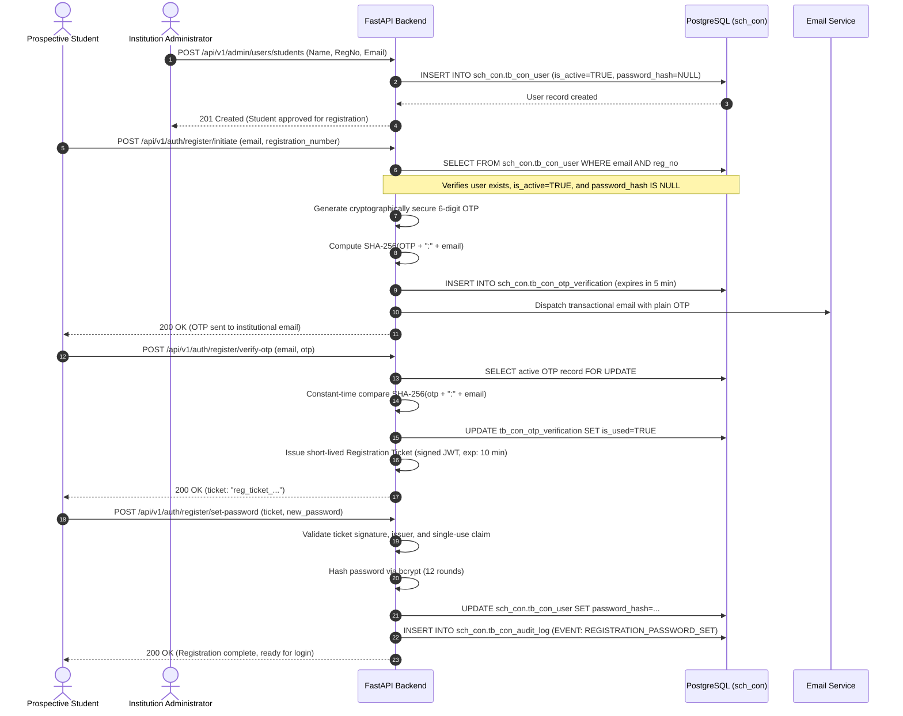
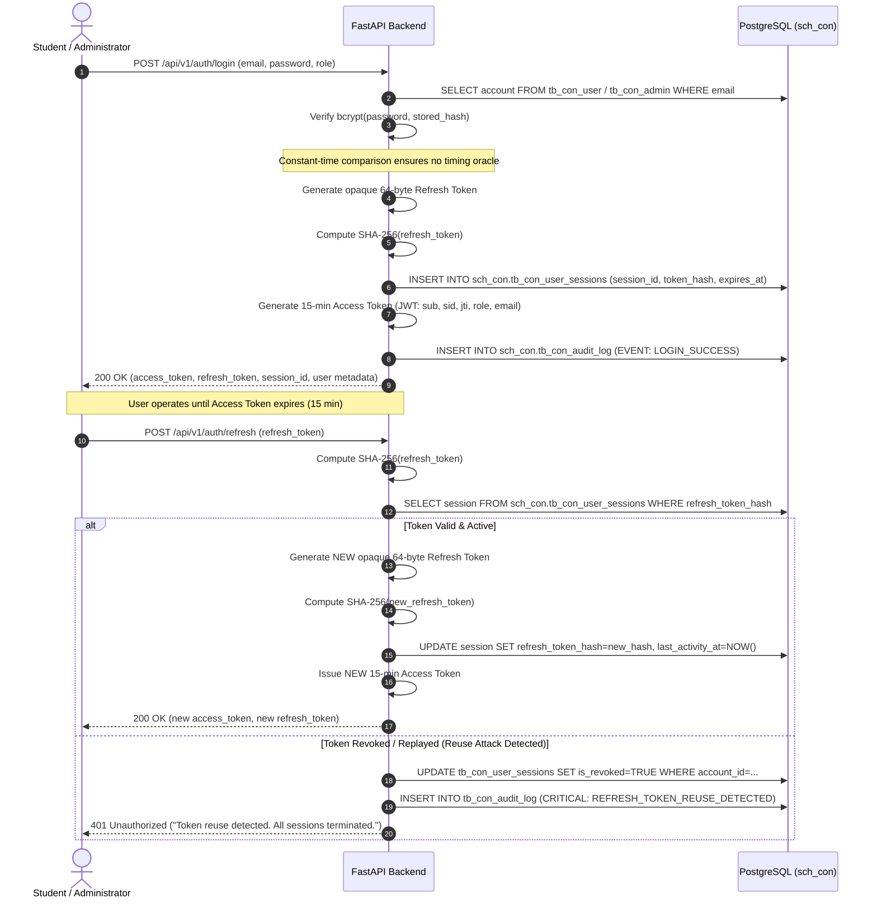
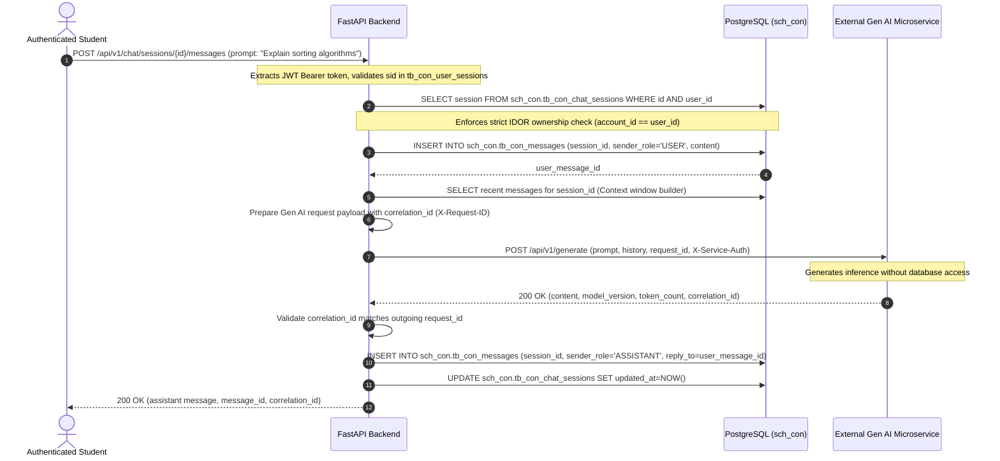

# MAIRA Phase 1 Backend — System Architecture

## 1. Architectural Philosophy and Design Principles

The MAIRA Phase 1 Backend is engineered as an enterprise-grade, institutional conversational AI backend supporting authenticated institutional users (students, faculty) and administrators. It enforces strict separation of concerns, defense-in-depth security, deterministic transaction management, and an isolated integration boundary with an external Gen AI microservice.

### Core Architectural Pillars
1. **Layered Separation of Concerns**: Strict decoupling across API presentation, authentication/authorization middleware, domain services, data access repositories, and database ORM entities.
2. **Stateless Scalability**: Application state resides exclusively in PostgreSQL (`sch_con.tb_con_user_sessions`) and signed cryptographic tokens (JWTs), enabling horizontal scaling behind a reverse proxy or load balancer.
3. **Database-as-Single-Source-of-Truth**: All business integrity rules, audit trails, and conversational histories are stored in PostgreSQL under schema `sch_con`. The Gen AI service operates strictly as a stateless compute engine with zero direct database access.
4. **Resilient Microservice Integration**: Resilient, non-blocking asynchronous HTTP communication with the Gen AI service via connection pooling, correlation tracing (`X-Request-ID`), granular timeouts, bounded retries with jitter, and controlled degradation.

---

## 2. Layered Architecture

The system is structured in five distinct horizontal layers:

```
+-----------------------------------------------------------------------------------+
|                            HTTP / REST CLIENTS                                    |
|                      (Web Frontend, Mobile App, Admin UI)                         |
+-----------------------------------------------------------------------------------+
                                         │
                                         ▼ HTTPS / JSON
+-----------------------------------------------------------------------------------+
| 1. PRESENTATION & SECURITY MIDDLEWARE LAYER (FastAPI)                            |
|    - SecurityHeadersMiddleware (HSTS, CSP, X-Frame-Options, X-Content-Type)       |
|    - CORSMiddleware (Explicit origin allowlist, credential support)               |
|    - CorrelationIdMiddleware (X-Request-ID injection & context propagation)       |
|    - RateLimiter (In-memory sliding window per IP and action)                     |
|    - Global Exception Handlers (AppException -> RFC 7807 compatible JSON)        |
+-----------------------------------------------------------------------------------+
                                         │
                                         ▼ Validated Requests
+-----------------------------------------------------------------------------------+
| 2. API ROUTING & DEPENDENCY INJECTION LAYER (app/api/v1/)                         |
|    - auth.py: /api/v1/auth (Register, Verify OTP, Set Password, Login, Refresh)   |
|    - users.py: /api/v1/users (Profile retrieval, self-service data)              |
|    - admin.py: /api/v1/admin/users (Student onboarding, status management)       |
|    - chat.py: /api/v1/chat (Conversation CRUD, message streaming/sending)        |
|    - main.py: /health (Liveness, readiness, DB connection pool checks)           |
|    - Dependencies (app/api/dependencies.py):                                      |
|      * get_db(): Scoped AsyncSession with automatic transaction rollback         |
|      * get_current_user(): Bearer JWT validation & active session verification    |
|      * require_role(): Strict RBAC role enforcement (ADMIN, STUDENT, FACULTY)    |
|      * require_permission(): Granular capability enforcement                      |
+-----------------------------------------------------------------------------------+
                                         │
                                         ▼ Domain Calls
+-----------------------------------------------------------------------------------+
| 3. DOMAIN SERVICE LAYER (app/services/)                                           |
|    - AuthService: Orchestrates credentials, token lifecycle, session revoking     |
|    - OTPService: Cryptographic OTP generation, SHA-256 email-salted verification |
|    - UserService: User profile, administrative lifecycle, analytics               |
|    - ChatService: Conversation authorization, message persistence, context window|
|    - EmailService: Transactional email dispatcher (SMTP, Console, Mock outbox)    |
|    - GenAIClient: Async HTTP client to external Gen AI microservice               |
|    - AuditLogger: High-level security audit recorder                              |
+-----------------------------------------------------------------------------------+
                                         │
                    ┌────────────────────┴────────────────────┐
                    ▼                                         ▼
+----------------------------------------+ +----------------------------------------+
| 4. REPOSITORY LAYER (app/repositories/)| | EXTERNAL GEN AI MICROSERVICE           |
|    - UserRepository                    | | (FastAPI / PyTorch / vLLM)             |
|    - SessionRepository                 | | POST /api/v1/generate                  |
|    - OTPRepository                     | | - Strict X-Service-Auth shared secret  |
|    - ChatRepository                    | | - Request-Response correlation ID      |
|    - AuditRepository                   | | - Zero database access                 |
+----------------------------------------+ +----------------------------------------+
                    │
                    ▼ SQLAlchemy Async ORM
+-----------------------------------------------------------------------------------+
| 5. DATA PERSISTENCE LAYER (PostgreSQL 18.6 - Database: mira_db, Schema: sch_con)  |
|    - tb_con_user: Approved institutional student records                         |
|    - tb_con_admin: Institutional administrators                                   |
|    - tb_con_user_sessions: Active user sessions, hashed refresh tokens            |
|    - tb_con_otp_verification: Hashed OTPs, expiration, attempts counter          |
|    - tb_con_chat_sessions: Conversation metadata, active/deleted flags            |
|    - tb_con_messages: Chat messages, role (USER/ASSISTANT), metadata              |
|    - tb_con_audit_log: Immutable security audit trail                             |
+-----------------------------------------------------------------------------------+
```

---

## 3. End-to-End System Data Flows

### 3.1. Administrator-Controlled Registration & OTP Flow



---

### 3.2. Authentication, Session Establishment & Token Refresh



---

### 3.3. Conversational Chat & Gen AI Microservice Orchestration



---

## 4. Subsystem Breakdown

### 4.1. Core Configuration & Secrets (`app/core/`, `app/security/`)
- **`app/core/config.py`**: Immutable Pydantic Settings reading environment variables with zero fallback to insecure defaults for critical secrets.
- **`app/security/secrets.py`**: Multi-tiered secrets retrieval hierarchy (Environment Variable -> Docker Secret File `/run/secrets/*` -> Disk File Pointer `*_FILE`). Sensitive values are masked automatically (`mask_secret`) during string representation.
- **`app/utils/redaction.py`**: Recursive sanitization engine removing passwords, tokens, API keys, and authorization headers from logging structures and exception outputs.

### 4.2. Database & Persistence Layer (`app/models/`, `app/repositories/`)
- **Schema Isolation**: All tables are bound to PostgreSQL schema `sch_con`. No table exists in public schema.
- **Connection Management**: Async engine configured with `NullPool` during testing and asynchronous queue connection pooling (`pool_size=10, max_overflow=20`) in production, with `pool_pre_ping=True` and connection recycles every 1800s.
- **Deterministic Ordering**: Message persistence uses explicit `created_at ASC, reply_to_message_id NULLS FIRST` to guarantee user-assistant turn sequences even when timestamps coincide within atomic transactions.

### 4.3. Security & Access Control (`app/security/`, `app/api/dependencies.py`)
- **Role-Based Access Control (RBAC)**: Defined in `app/security/permissions.py`. Roles `ADMIN`, `STUDENT`, `FACULTY` map to declarative permissions enforced via FastAPI dependencies.
- **IDOR Safeguards**: Cross-user conversation access is blocked at the SQL query level by binding queries to both the resource primary key and authenticated `account_id` and `account_type`.
- **Security Headers & In-Flight Protection**: Middleware applies Strict-Transport-Security (HSTS), Content-Security-Policy (CSP), X-Frame-Options (`DENY`), and X-Content-Type-Options (`nosniff`).

### 4.4. Gen AI Integration Subsystem (`app/services/genai_client.py`)
- **Decoupled Boundary**: The Gen AI microservice is treated as an untrusted, external HTTP dependency.
- **Mutual Authentication**: Secured via `X-Service-Auth` header bearing a shared secret.
- **Correlation Tracking**: Client-generated `request_id` is propagated and strictly asserted upon receipt.
- **Resilience**: Configured with 5.0s connect timeout, 30.0s read timeout, and bounded retries with exponential backoff on HTTP 502/503/504 errors.
