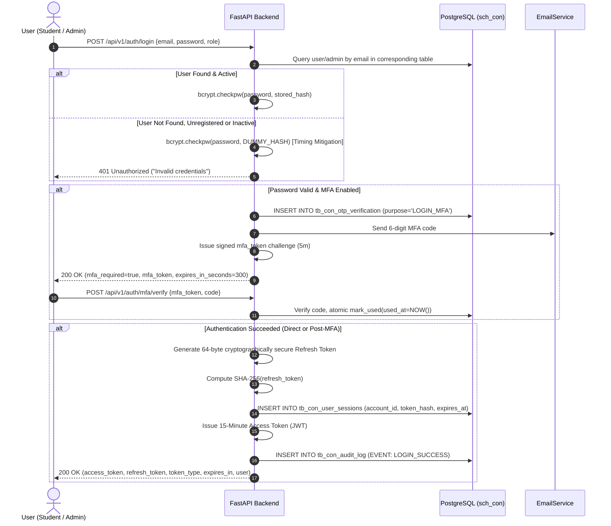

# MAIRA Phase 1 Backend — Authentication & Authorization Flow

This document details the complete identity, authentication, session lifecycle, and authorization mechanisms implemented in the MAIRA Phase 1 Backend.

---

## 1. Identity & Credential Architecture

MAIRA Phase 1 enforces an institution-governed identity model:
1. **No Public Self-Registration**: Only students pre-approved by an institution administrator can activate accounts.
2. **Dual-Tier Identity Entities**:
   - `sch_con.tb_con_user`: Institutional students with departmental attributes.
   - `sch_con.tb_con_admin`: System administrators with elevated onboarding and management capabilities.
3. **Defense Against Timing Oracles**:
   - Password verification utilizes `bcrypt.checkpw` with 12 salt rounds.
   - For non-existent accounts or unactivated students (`password_hash IS NULL`), the backend executes a dummy bcrypt comparison against a precomputed constant hash to ensure uniform execution timing regardless of account existence.

---

## 2. Administrator-Controlled Registration Flow

```
[Administrator] ───────────────> Approves Student in tb_con_user (password_hash = NULL)
                                              │
[Student]       ──(1) Initiate Register─────> Validates Email + Reg Number
                                              ├── Generates 6-Digit Cryptographic OTP
                                              ├── Hashes SHA-256(OTP + ":" + Email)
                                              ├── Stores in tb_con_otp_verification
                                              └── Dispatches Email via EmailService
                                              │
[Student]       ──(2) Verify OTP────────────> Constant-Time Verification
                                              ├── Verifies attempts <= 5, not expired
                                              ├── Marks OTP used (is_used = TRUE)
                                              └── Issues signed Registration Ticket (10m)
                                              │
[Student]       ──(3) Set Password──────────> Validates Registration Ticket
                                              ├── Enforces complexity policy
                                              ├── Hashes password (bcrypt, 12 rounds)
                                              ├── Updates tb_con_user.password_hash
                                              └── Writes Audit Log (REGISTRATION_COMPLETE)
```

### 2.1. Cryptographic OTP Generation & Salting
- **Algorithm**: `secrets.randbelow(1_000_000)` zero-padded to 6 digits (`000000`–`999999`).
- **Storage Protection**: The plain OTP is never stored in the database.
- **Salt Strategy**: SHA-256 with institutional email binding:
  $$\text{Hash} = \text{SHA-256}(\text{OTP} \mathbin{\Vert} \text{":"} \mathbin{\Vert} \text{email})$$
  This email-binding salt prevents cross-user rainbow table precomputation and ensures an OTP intercepted for one address cannot validate against another.
- **Brute-Force Countermeasure**: A hard limit of **5 failed attempts** per OTP record. Upon the 6th failed attempt, the record is invalidated, and the student must re-initiate registration.
- **Expiration Window**: 5 minutes (300 seconds) from issuance.
- **Single-Use Guarantee**: Atomic row update `is_used = TRUE` during verification.

### 2.2. Registration Ticket Specification
Upon successful OTP verification, the client receives a single-use JWT registration ticket:
- **Lifetime**: 10 minutes (600 seconds).
- **Claims**:
  - `sub`: User UUID.
  - `email`: Student institutional email.
  - `type`: `"registration_ticket"` (strictly rejected if presented as a Bearer access token).
  - `jti`: Unique ticket nonce preventing replay.
  - `iss`: `"maira-backend"`
  - `aud`: `"maira-frontend"`

---

## 3. Login & Session Establishment (With Optional Two-Step MFA)



---

## 4. Token Architecture & Refresh Token Rotation

### 4.1. JWT Access Token Design
Access tokens are signed JSON Web Tokens designed for fast, stateless verification with database revocation validation:
- **Algorithm**: `HS256` (HMAC with SHA-256).
- **Secret Key**: Minimum 32-byte cryptographic secret loaded via `app.security.secrets`.
- **Expiration**: 15 minutes (900 seconds).
- **Token Claims Payload**:
  ```json
  {
    "sub": "11111111-1111-1111-1111-111111111111",
    "sid": "9b1deb4d-3b7d-4bad-9bdd-2b0d7b3dcb6d",
    "jti": "5a6b7c8d-9e0f-1a2b-3c4d-5e6f7a8b9c0d",
    "iat": 1794484800,
    "exp": 1794485700,
    "iss": "maira-backend",
    "aud": "maira-frontend",
    "type": "access_token",
    "role": "STUDENT",
    "email": "student@institution.edu"
  }
  ```
- **Validation Constraints**:
  - The `sid` (session ID) is checked against `sch_con.tb_con_user_sessions` to verify that the parent session has not been revoked by logout, admin deactivation, or token reuse detection.
  - Algorithms `none`, asymmetric RS256 with mismatched keys, or unknown issuers are strictly rejected.

### 4.2. Opaque Refresh Token Lifecycle & Atomic Rotation
Refresh tokens are high-entropy, opaque strings:
- **Generation**: `secrets.token_urlsafe(64)` yielding ~86 URL-safe characters with 512 bits of entropy.
- **Storage Security**: Only the SHA-256 digest of the refresh token is stored in `tb_con_user_sessions`. Even in the event of a database read breach, cleartext refresh tokens cannot be recovered.
- **Rotation Protocol**: Every call to `POST /api/v1/auth/refresh` immediately invalidates the presented refresh token and issues a new refresh token.

### 4.3. Automatic Refresh Token Reuse / Theft Detection
To protect institutional accounts against stolen refresh tokens:
1. When a refresh token is presented, the backend looks up its SHA-256 hash.
2. If the hash matches an existing session where `is_revoked = TRUE`:
   - **Theft Event Detected**: An attacker or client is replaying an already-rotated token.
   - **Remediation**: The backend immediately executes:
     ```sql
     UPDATE sch_con.tb_con_user_sessions
     SET is_revoked = TRUE
     WHERE account_id = :account_id;
     ```
   - **Audit Alert**: Emits a critical severity audit log `REFRESH_TOKEN_REUSE_DETECTED`.
   - **Response**: Rejects request with `401 Unauthorized` (`"Session revoked due to detected token reuse. Please log in again."`).

---

## 5. Role-Based Access Control (RBAC) Matrix

MAIRA Phase 1 defines three distinct institutional roles:

| Permission | Description | `ADMIN` | `STUDENT` | `FACULTY` |
|---|---|:---:|:---:|:---:|
| `student:create` | Onboard approved student records | ✅ | ❌ | ❌ |
| `student:activate` | Re-enable suspended student accounts | ✅ | ❌ | ❌ |
| `student:deactivate`| Suspend student accounts (revokes sessions)| ✅ | ❌ | ❌ |
| `student:delete` | Soft delete / remove student profiles | ✅ | ❌ | ❌ |
| `student:view_basic`| View basic student directory information | ✅ | ✅ | ✅ |
| `student:analytics:view`| View aggregate institutional metrics | ✅ | ❌ | ❌ |
| `profile:view_own` | Retrieve own account details | ✅ | ✅ | ✅ |
| `ai:use` | Query Gen AI microservice | ❌ | ✅ | ✅ |
| `chat:create` | Initialize new conversation sessions | ❌ | ✅ | ✅ |
| `chat:view_own` | View own conversational history | ❌ | ✅ | ✅ |
| `chat:delete_own` | Soft delete own conversations | ❌ | ✅ | ✅ |

### Enforcement in API Routes
Permissions are enforced declaratively in endpoint signatures using FastAPI dependencies:
```python
@router.post("/students", dependencies=[Depends(require_permission("student:create"))])
async def create_student(...):
    ...
```

---

## 6. Insecure Direct Object Reference (IDOR) Mitigation

Conversational threads and messages are strictly segregated per user:
1. **No Client-Supplied Account IDs**: The backend extracts `user_id` exclusively from the verified JWT claims (`sub`), never from route parameters or request bodies.
2. **Compound SQL Scoping**: When fetching or updating chat sessions, queries enforce compound ownership:
   ```python
   stmt = select(ChatSession).where(
       ChatSession.id == session_id,
       ChatSession.user_id == current_user.account_id,
       ChatSession.is_active == True
   )
   ```
   If a user requests a conversation belonging to another user, the query returns `None`, resulting in a safe `404 Not Found` or `403 Forbidden` without leaking the existence of other records.
