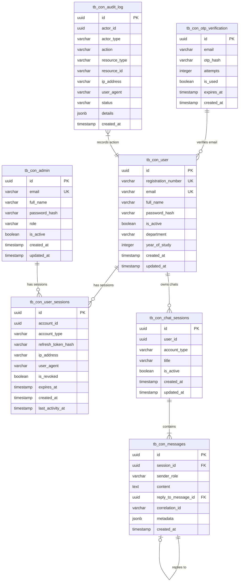

# MAIRA Phase 1 Backend — Database Integration Guide

This document describes the persistence architecture, table definitions, relational constraints, connection pooling, and schema preservation policies for the MAIRA Phase 1 PostgreSQL database.

## 1. Database Environment Overview

- **Engine**: PostgreSQL 18.6
- **Database Name**: `mira_db`
- **Schema**: `sch_con`
- **ORM Engine**: SQLAlchemy 2.0 (AsyncIO)
- **Async Driver**: `asyncpg` (`postgresql+asyncpg://`)
- **Sync Driver (Verification/Fallback)**: `psycopg2-binary` (`postgresql://`)

---

## 2. Table Specifications in Schema `sch_con`

All MAIRA Phase 1 entities reside exclusively within schema `sch_con`. The schema contains 7 tables designed to maintain institutional student and administrative records, authentication state, conversations, and immutable audit trails.



---

### 2.1. `sch_con.tb_con_user` (Institutional Students)
Stores pre-approved and registered student profiles.

| Column | Type | Constraints | Description |
|---|---|---|---|
| `id` | `UUID` | PRIMARY KEY, `gen_random_uuid()` | Unique student identifier |
| `registration_number` | `VARCHAR(64)` | UNIQUE, NOT NULL | Institutional registration number (e.g. `REG2026001`) |
| `email` | `VARCHAR(255)` | UNIQUE, NOT NULL | Institutional email address |
| `full_name` | `VARCHAR(255)` | NOT NULL | Official full name |
| `password_hash` | `VARCHAR(255)` | NULLABLE | Bcrypt hash (NULL until student completes OTP setup) |
| `is_active` | `BOOLEAN` | DEFAULT `TRUE`, NOT NULL | Administrative enablement flag |
| `department` | `VARCHAR(128)` | NULLABLE | Academic department |
| `year_of_study` | `INTEGER` | NULLABLE | Academic study year (1-5) |
| `created_at` | `TIMESTAMPTZ` | DEFAULT `NOW()`, NOT NULL | Record creation timestamp |
| `updated_at` | `TIMESTAMPTZ` | DEFAULT `NOW()`, NOT NULL | Record modification timestamp |

---

### 2.2. `sch_con.tb_con_admin` (Institutional Administrators)
Maintains administrative credentials for student onboarding and system management.

| Column | Type | Constraints | Description |
|---|---|---|---|
| `id` | `UUID` | PRIMARY KEY, `gen_random_uuid()` | Unique administrator identifier |
| `email` | `VARCHAR(255)` | UNIQUE, NOT NULL | Administrator institutional email |
| `full_name` | `VARCHAR(255)` | NOT NULL | Administrator full name |
| `password_hash` | `VARCHAR(255)` | NOT NULL | Bcrypt hash of administrator password |
| `role` | `VARCHAR(32)` | DEFAULT `'ADMIN'`, NOT NULL | Access tier |
| `is_active` | `BOOLEAN` | DEFAULT `TRUE`, NOT NULL | Enablement status |
| `created_at` | `TIMESTAMPTZ` | DEFAULT `NOW()`, NOT NULL | Account creation timestamp |
| `updated_at` | `TIMESTAMPTZ` | DEFAULT `NOW()`, NOT NULL | Account modification timestamp |

---

### 2.3. `sch_con.tb_con_user_sessions` (Active Sessions & Refresh Tokens)
Tracks client sessions, active refresh tokens, and revocation status for both students and administrators.

| Column | Type | Constraints | Description |
|---|---|---|---|
| `id` | `UUID` | PRIMARY KEY, `gen_random_uuid()` | Unique session identifier (`sid`) |
| `account_id` | `UUID` | NOT NULL | Associated user or admin identifier |
| `account_type` | `VARCHAR(32)` | NOT NULL | `'STUDENT'` or `'ADMIN'` |
| `refresh_token_hash`| `VARCHAR(255)` | NOT NULL, INDEX | SHA-256 hash of opaque 64-byte refresh token |
| `ip_address` | `VARCHAR(45)` | NULLABLE | Client IP address at session creation |
| `user_agent` | `VARCHAR(512)` | NULLABLE | Client browser/device User-Agent |
| `is_revoked` | `BOOLEAN` | DEFAULT `FALSE`, NOT NULL | Explicit revocation flag (logout or theft detection) |
| `expires_at` | `TIMESTAMPTZ` | NOT NULL | Absolute expiration (typically 7 days) |
| `created_at` | `TIMESTAMPTZ` | DEFAULT `NOW()`, NOT NULL | Session creation timestamp |
| `last_activity_at` | `TIMESTAMPTZ` | DEFAULT `NOW()`, NOT NULL | Timestamp of last access token refresh |

---

### 2.4. `sch_con.tb_con_otp_verification` (OTP Security State)
Manages transient verification tokens, tracking attempt counters to thwart brute-force attacks.

| Column | Type | Constraints | Description |
|---|---|---|---|
| `id` | `UUID` | PRIMARY KEY, `gen_random_uuid()` | Unique OTP record ID |
| `email` | `VARCHAR(255)` | NOT NULL, INDEX | Target institutional email |
| `otp_hash` | `VARCHAR(255)` | NOT NULL | SHA-256(`otp:email`) salted digest |
| `attempts` | `INTEGER` | DEFAULT `0`, NOT NULL | Consecutive failed verification attempts (max 5) |
| `is_used` | `BOOLEAN` | DEFAULT `FALSE`, NOT NULL | Single-use consumption flag |
| `expires_at` | `TIMESTAMPTZ` | NOT NULL | Expiry deadline (5 minutes from issuance) |
| `created_at` | `TIMESTAMPTZ` | DEFAULT `NOW()`, NOT NULL | Issuance timestamp |

---

### 2.5. `sch_con.tb_con_chat_sessions` (Conversational Threads)
Tracks chat sessions owned by individual students.

| Column | Type | Constraints | Description |
|---|---|---|---|
| `id` | `UUID` | PRIMARY KEY, `gen_random_uuid()` | Unique conversation ID |
| `user_id` | `UUID` | NOT NULL, INDEX | Owning student ID |
| `account_type` | `VARCHAR(32)` | DEFAULT `'STUDENT'`, NOT NULL | Owning account type |
| `title` | `VARCHAR(255)` | DEFAULT `'New Chat'`, NOT NULL | Conversation title |
| `is_active` | `BOOLEAN` | DEFAULT `TRUE`, NOT NULL | Active status (set to `FALSE` upon soft deletion) |
| `created_at` | `TIMESTAMPTZ` | DEFAULT `NOW()`, NOT NULL | Conversation start timestamp |
| `updated_at` | `TIMESTAMPTZ` | DEFAULT `NOW()`, NOT NULL | Last message timestamp |

---

### 2.6. `sch_con.tb_con_messages` (Chat Turns)
Maintains conversation turns between users and the Gen AI assistant.

| Column | Type | Constraints | Description |
|---|---|---|---|
| `id` | `UUID` | PRIMARY KEY, `gen_random_uuid()` | Unique message ID |
| `session_id` | `UUID` | NOT NULL, FK -> `tb_con_chat_sessions.id` | Associated chat thread |
| `sender_role` | `VARCHAR(32)` | NOT NULL | `'USER'` or `'ASSISTANT'` |
| `content` | `TEXT` | NOT NULL | Message text |
| `reply_to_message_id`| `UUID` | NULLABLE, FK -> `tb_con_messages.id` | Parent prompt reference (for assistant turns) |
| `correlation_id` | `VARCHAR(64)` | NULLABLE | End-to-end `X-Request-ID` tracing string |
| `metadata` | `JSONB` | NULLABLE | Model metadata, token counts, or flags |
| `created_at` | `TIMESTAMPTZ` | DEFAULT `NOW()`, NOT NULL | Message persistence timestamp |

---

### 2.7. `sch_con.tb_con_audit_log` (Immutable Audit Trail)
Records security-sensitive system events, authentications, role modifications, and administrative operations.

| Column | Type | Constraints | Description |
|---|---|---|---|
| `id` | `UUID` | PRIMARY KEY, `gen_random_uuid()` | Unique audit event ID |
| `actor_id` | `UUID` | NULLABLE | Performing user or admin ID |
| `actor_type` | `VARCHAR(32)` | NULLABLE | `'STUDENT'`, `'ADMIN'`, or `'SYSTEM'` |
| `action` | `VARCHAR(128)` | NOT NULL, INDEX | Event identifier (e.g. `LOGIN_SUCCESS`, `PASSWORD_SET`) |
| `resource_type` | `VARCHAR(64)` | NULLABLE | Target entity (`USER`, `SESSION`, `CHAT`) |
| `resource_id` | `VARCHAR(64)` | NULLABLE | Target entity ID |
| `ip_address` | `VARCHAR(45)` | NULLABLE | Client IP address |
| `user_agent` | `VARCHAR(512)` | NULLABLE | Client User-Agent |
| `status` | `VARCHAR(32)` | DEFAULT `'SUCCESS'`, NOT NULL | `'SUCCESS'`, `'FAILED'`, or `'DENIED'` |
| `details` | `JSONB` | NULLABLE | Sanitized contextual metadata (no plain secrets) |
| `created_at` | `TIMESTAMPTZ` | DEFAULT `NOW()`, NOT NULL | Event log timestamp |

---

## 3. Database Connection Pooling Architecture

Database connections are managed via SQLAlchemy 2.0 with asynchronous connection pooling tuned for institutional traffic loads.

### 3.1. Production Pool Configuration (`app/core/database.py`)
```python
engine = create_async_engine(
    settings.async_database_url,
    pool_size=settings.DB_POOL_SIZE,          # Default: 10 connections
    max_overflow=settings.DB_MAX_OVERFLOW,    # Default: 20 overflow connections
    pool_timeout=settings.DB_POOL_TIMEOUT,    # Default: 30 seconds
    pool_recycle=settings.DB_POOL_RECYCLE,    # Default: 1800 seconds (30 mins)
    pool_pre_ping=True,                       # Verifies connectivity before checkout
    echo=False                                # Disables query echoing in production
)
```

### 3.2. Test Environment Isolation (`tests/conftest.py`)
In automated tests (`pytest-asyncio`), connection pooling across isolated asynchronous event loops causes `RuntimeError: Event loop is closed`. To guarantee deterministic isolation, the test suite injects `NullPool`:
```python
test_engine = create_async_engine(
    settings.async_database_url,
    poolclass=NullPool,
    echo=False
)
```
Each test fixture executes in a fresh connection that rolls back automatically upon test teardown.

---

## 4. Absolute Non-Destructive Schema Preservation Policy

The database `mira_db` contains seeded institutional student and administrator records that must remain intact.

### Strict Operational Constraints
1. **NO DDL Destructive Commands**: Never execute `DROP TABLE`, `DROP SCHEMA`, `TRUNCATE`, or `CASCADE` commands against `mira_db`.
2. **Schema Binding**: Every query must reference `sch_con`. All SQLAlchemy models explicitly define `__table_args__ = {"schema": "sch_con"}`.
3. **No Automatic Migrations**: Alembic auto-generation must not be executed against production without strict manual review.
4. **Preflight Verification**: The read-only verification script `scripts/verify_db.py` must be executed prior to any backend startup to confirm that all 7 tables exist and record counts are intact.

### Running Preflight Verification
```bash
python scripts/verify_db.py
```
Output:
```
============================================================
MAIRA Phase 1 — Database Preflight Verification
============================================================
Checking connection to PostgreSQL mira_db...
[OK] Connection established successfully.

[OK] Found 7 tables in schema 'sch_con':
  - sch_con.tb_con_admin
  - sch_con.tb_con_audit_log
  - sch_con.tb_con_chat_sessions
  - sch_con.tb_con_messages
  - sch_con.tb_con_otp_verification
  - sch_con.tb_con_user
  - sch_con.tb_con_user_sessions

[INFO] Total approved user records in database: 18
[INFO] Total administrator records in database: 1

[SUCCESS] mira_db is ready for application use.
```
